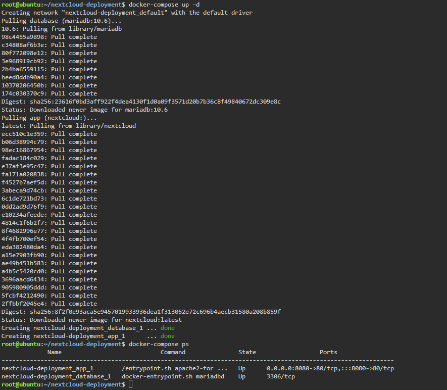

# Docker Compose Guide

## The Code
This is the `docker-compose.yml` file used to deploy the Nextcloud stack:

```yaml
version: '3'
services:
  database:
    image: mariadb:10.6
    environment:
      - MYSQL_ROOT_PASSWORD=cloudnova_root
      - MYSQL_PASSWORD=cloudnova_pass
      - MYSQL_DATABASE=nextcloud_db
      - MYSQL_USER=nextcloud_user
  app:
    image: nextcloud
    ports:
      - 8080:80
    environment:
      - MYSQL_PASSWORD=cloudnova_pass
      - MYSQL_DATABASE=nextcloud_db
      - MYSQL_USER=nextcloud_user
      - MYSQL_HOST=database
```

## What does the services: block do?
The `services:` block lists every container that makes up the application. Each name under it is one service, and in this file there are two: `database` and `app`. Each service has its own settings, such as the image to use, the ports to expose, and the environment variables to pass in. Docker Compose reads this block and creates and starts one container for each service.

## How did the Nextcloud app container find the database container?
The `app` service has the environment variable `MYSQL_HOST=database`. The value `database` is the name of the other service in the file. Docker Compose automatically puts all services in the same private network and lets them reach each other by service name. When Nextcloud tries to connect to the host called `database`, Docker resolves that name to the MariaDB container. No IP address needs to be typed in.

## What is the difference between docker run and docker-compose up -d?
`docker run` starts one single container, and every option (ports, environment variables, name) must be typed out in the command each time. `docker-compose up -d` reads a `docker-compose.yml` file and starts every container described in it together, creating the shared network as well, and it runs them in the background. The file can be saved, reused, and shared, so the same deployment can be repeated exactly. This is the idea behind Infrastructure as Code.

## Screenshots

