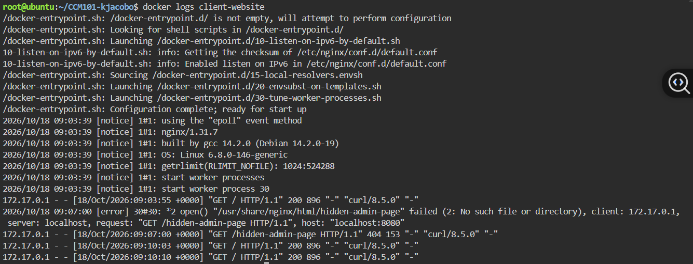
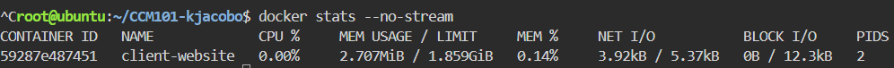

# Container Observability

## Application Logs

### The 404 Error Entry
```
172.17.0.1 - - [18/Oct/2026:09:07:00 +0000] "GET /hidden-admin-page HTTP/1.1" 404 153 "-" "curl/8.5.0" "-"
```



### Why Application Logs Are Vital for Troubleshooting
Application logs record every request along with its time, the requester's address, the page asked for and the result code, so an engineer can see exactly what happened when something breaks. Without them, finding the cause of a failure would mean guessing, but with them a problem like this 404 can be traced in seconds.


## Real-Time Container Metrics

| Metric | Value |
|---|---|
| Container | client-website |
| Memory Usage | [your exact value, e.g. 3.5MiB] |
| CPU Percentage | [your exact value, e.g. 0.00%] |


