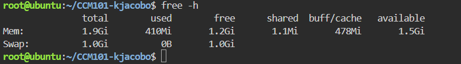
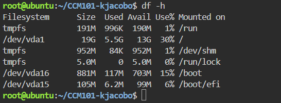

# System Baseline Report

## Host Server Resources

| Resource | Value |
|---|---|
| Total RAM available | 1.9Gi |
| Root (/) file system capacity | 19G |

## Evidence

## Why Disk Space Matters Before a Traffic Surge
A traffic surge produces large amounts of logs, uploads and temporary files, so a nearly full disk can stop the server from writing data and cause it to crash.
