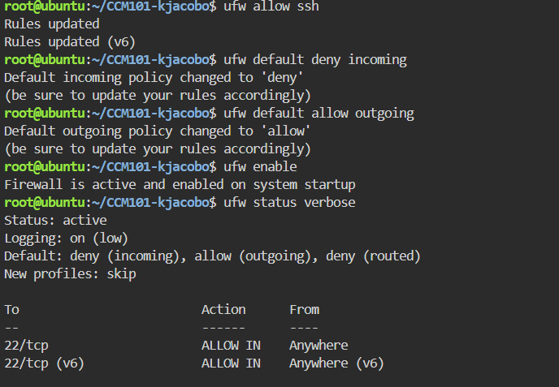
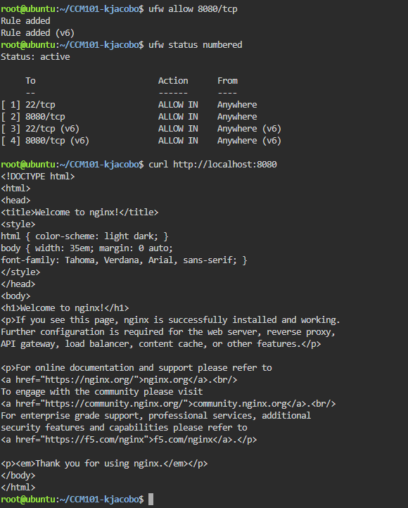

# Firewall Configuration

## Allow SSH
```
sudo ufw allow ssh
```
This opens port 22 so administrators can keep managing the server remotely.

## Default Deny Policy
```
sudo ufw default deny incoming
sudo ufw default allow outgoing
```
The first command blocks all incoming traffic unless a rule allows it. The second lets the server make outgoing connections, such as downloading updates.

## Activate the Firewall
```
sudo ufw enable
sudo ufw status verbose
```

## Allow Port 8080
```
sudo ufw allow 8080/tcp
sudo ufw status numbered
```
This adds a specific rule so users can reach the web application on port 8080.

## What Would Happen If ufw enable Ran Before ufw allow ssh?
If the firewall were enabled before SSH was allowed, the default deny policy would block port 22, and the administrator would be locked out of their own remote server.

## Evidence


