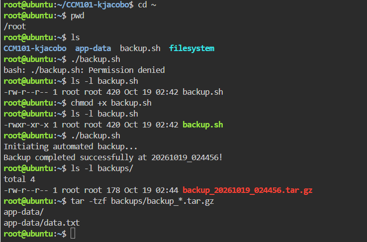
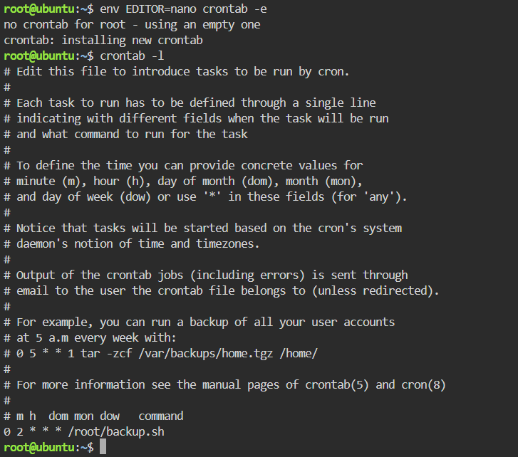

# Backup Script Guide

## The Script: backup.sh
```bash
#!/bin/bash
# Automated Backup Script for CloudNova Technologies
SOURCE_DIR="app-data"
BACKUP_DIR="backups"
TIMESTAMP=$(date +"%Y%m%d_%H%M%S")
echo "Initiating automated backup..."
# Create the backup directory if it does not exist
mkdir -p $BACKUP_DIR
# Compress the source directory into a tarball (.tar.gz)
tar -czf $BACKUP_DIR/backup_$TIMESTAMP.tar.gz $SOURCE_DIR
echo "Backup completed successfully at $TIMESTAMP!"
```

The script stores the folder to protect and the destination folder in variables, builds a timestamp from the current date and time, creates the backup folder if it is missing, and compresses `app-data` into a `.tar.gz` file whose name includes the timestamp. Because every backup has a different timestamp, new backups never overwrite old ones.

## What chmod +x Did
By default, a new text file in Linux is not allowed to run as a program, which is why `./backup.sh` first returned "Permission denied". The command `chmod +x backup.sh` added the execute permission to the file, which changed its permissions from `-rw-r--r--` to `-rwxr-xr-x`. After that, the system was allowed to run the file as a script.

## The Cron Expression
```
0 2 * * * /root/backup.sh
```

| Field | Position | Value | Meaning |
|---|---|---|---|
| Minute | 1st | 0 | At minute 0 of the hour |
| Hour | 2nd | 2 | At 2 AM (24-hour clock) |
| Day of Month | 3rd | * | Every day of the month |
| Month | 4th | * | Every month |
| Day of Week | 5th | * | Every day of the week |

Together, these fields tell the cron scheduler to run `/root/backup.sh` every night at exactly 2:00 AM. The `*` character means "every". The full path `/root/backup.sh` is used so that cron can find the script no matter where it starts from.

## Evidence


